## Task 6

1. Operators Expected : 

- Index Seek / Scan
- Filter
- Nested loops
- Sort

2. Measurement Info : 
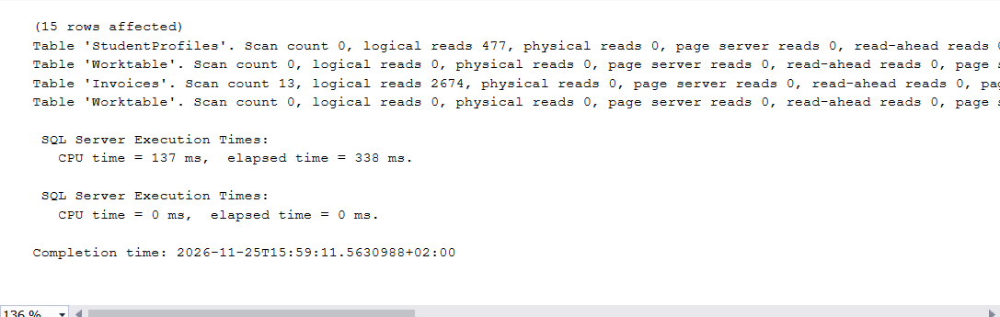

- Scan count -> Number of scans done on a table or index
- Logical reads -> number of data pages read from buffer cache
- Physical reads -> number of data pages read from physical storage
- Read-ahead reads -> number of pages taken into memory before they are requested
- CPU time -> time spent processing on cpu
- elapsed time -> total time taken to execute the query

3. Actual Plan & Operators :
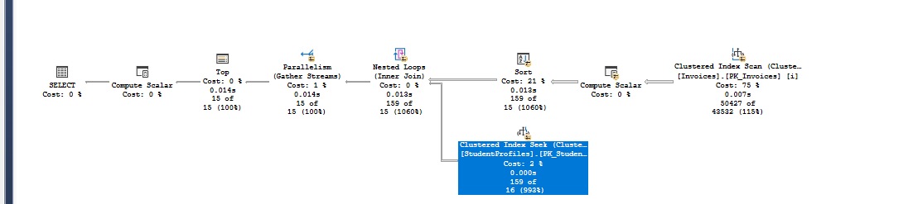

- Clustered Index Scan -> SQL Server reads index entries because it estimates that scanning is cheaper than seeking individual records

- Clustered Index Seek -> SQL Server can navigate directly to index entries instead of scanning the entire index

- Compute Scalar -> To compute new values from existing values in a row such as Remaining and Urgency

- Sort -> to sort the rows according to ORDER BY Remaining DESC;

- Nested loops -> to preform inner join, it is useful when the input is small

- Gather stream -> to collect rows from all workers threads into one stream

- Top -> executing sorting and limiting to find the highest 15 values

- Select -> returns the final result

4. Operators Properties :

- Logical Operation : the operation needed to be done
- Physical Operation : how the operation is done (like using nested loops to execute inner join)

- Estimated Execution mode : Row mode, the optimizer planned to use row mode when compiling the query plan
- Actual Execution mode : the mode actually used to run the query which is row mode in our case

- Storage : how the data is stored on disk and in memory (it is stored as traditional rows in our case)

- Estimated row read : How many rows the operator expects to read
- Actual row read : How many rows the operator actually reads

- Estimated number of rows to be executed : Rows expected to come out from one run of the operator
- Estimated number of rows for all executions : estimates all runs together 1 run * n rows
- Actual number of rows for all executions : How many rows were actually processed or returned by that operator

- Estimated I/O Cost : Estimated cost of input/output operations
- Estimated CPU Cost : Estimated CPU processing cost
- Estimated Subtree Cost : Estimated cumulative cost of that operator and its children
- Estimated row size : Estimated size for each row to be stored

- the properties written above are common between operators except select operator
  that has some different properties

** Select Operator :

- Cached Plan Size : How much memory (in KB) the compiled execution plan occupies in the plan cache
- Estimated operator cost : the cost of select command
- Degree of Parallelism : The actual number of CPU threads used to execute the query
- Memory grant : The actual amount of memory (in KB) granted to the query at runtime for buffers

5. Expectations Vs Reality :

- I Expected 4 operators, 3 of them were right, 1 is wrong, and i missed some operators
- Why Filter operator is not included in the actual plan?
A. Because sometimes the sql server pushes the filter into another operator instead of doing it
   as an extra step
B. in our case it is pushed in seek/scan tables as predicate property

SELECT Id, Email
FROM identity.Users
WHERE YEAR(CreatedAtUtc) = 2026
AND MONTH(CreatedAtUtc) = 3;

## Task 7

1. 7.1

** Problem :
- Not SarGable WHERE condition : calculate the function for each row before checking the condition (Index Scan)
- Bad Measurements : high logical reads with high cpu and elapsed time

Logical Read Before : 
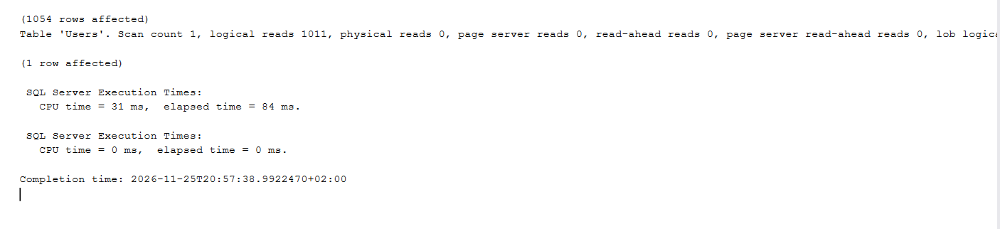

Logical Read After :
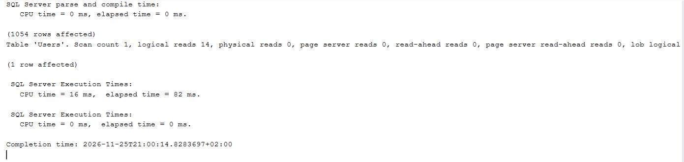

2. 7.2

** Problem :
- Not SarGable WHERE condition : Using DATEDIFF() on PaidAtUtc makes SQL Server calculate the difference for each row (Index Scan)
- Bad Measurements : high logical reads with high cpu and elapsed time

Logical Read Before : 
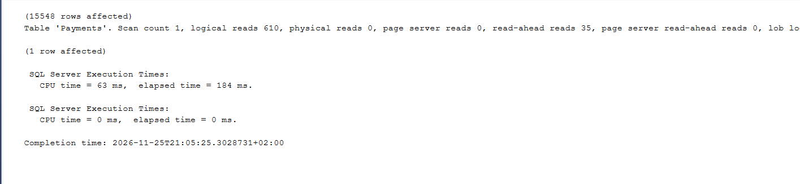

Logical Read After :
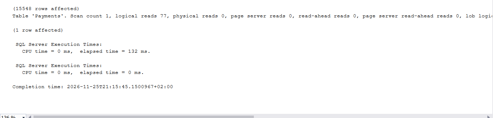

3. 7.3

** Problem :
- Not SarGable WHERE condition : Using LEFT() on LastName makes SQL Server evaluate the function for each row (Index Scan)
- Bad Measurements : high logical reads with high cpu and elapsed time

Logical Read Before : 
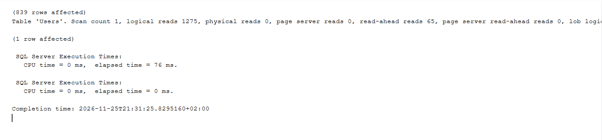

Logical Read After :

4. 7.4

** Problem :
- Not SarGable WHERE condition : Adding 1 to the Id column forces SQL Server to calculate Id + 1 for each row before comparing the result (Index Scan)
- Bad Measurements : high logical reads with high cpu and elapsed time

Logical Read Before : 
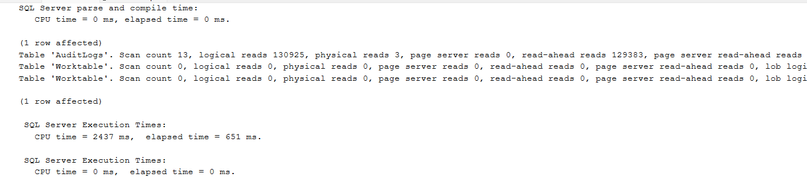

Logical Read After :
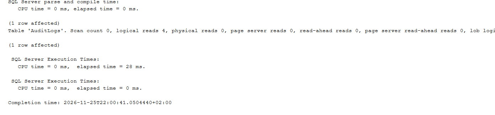

5. 7.5

** Problem :
- Not SarGable WHERE condition : InvoiceNumber is VARCHAR, but the value uses the prefix N, making it NVARCHAR,
  SQL Server may convert the column from VARCHAR to NVARCHAR during comparison, Because NVARCHAR has higher data type precedence, this can cause an implicit conversion on the column and prevent an efficient Index Seek (Index Scan)
- Bad Measurements : high logical reads with high cpu and elapsed time

Logical Read Before : 
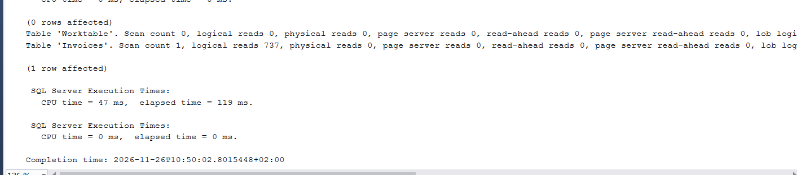

Logical Read After :
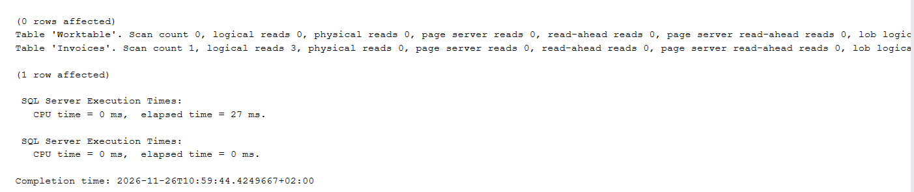

6. 7.6

** Problem
- Not SarGable WHERE condition : Using UPPER() on the Email column makes SQL Server calculate the uppercase value for each row (Index Scan),
  also SQL Server's default collations are usually case-insensitive, meaning ABC@example.com and abc@example.com compare as equal
- Bad Measurements : high logical reads with high cpu and elapsed time

Logical Read Before : 
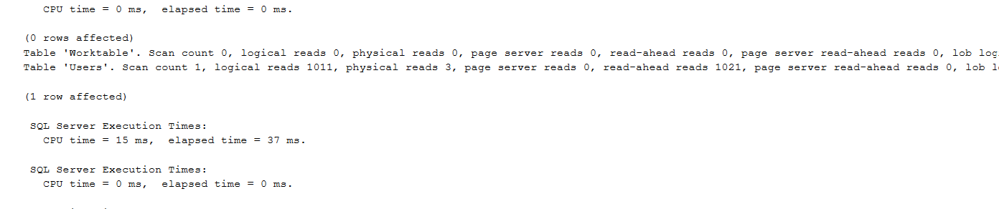

Logical Read After :
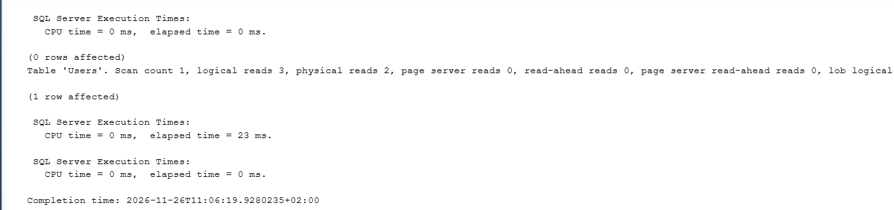

7. 7.7

** Problem
- Plan Cache Issue: SQL Server may create one cached execution plan that must work for both cases,
 This can result in a less efficient plan for the actual value (Index Scan)
- Bad Measurements : high logical reads with high cpu and elapsed time

Logical Read Before : 
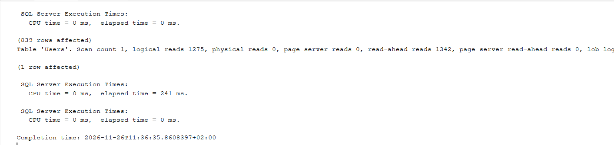

Logical Read After :
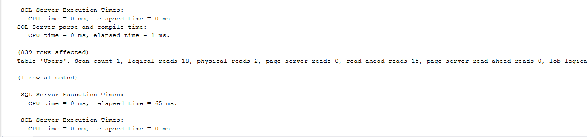

8. 7.8

** Problem
- Not SarGable WHERE condition : ISNULL() is applied to the indexed column Email, which can prevent SQL Server from using an efficient Index Seek

Logical Read Before : 
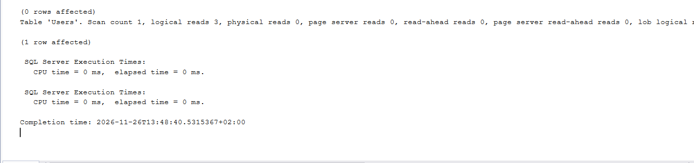

Logical Read After :
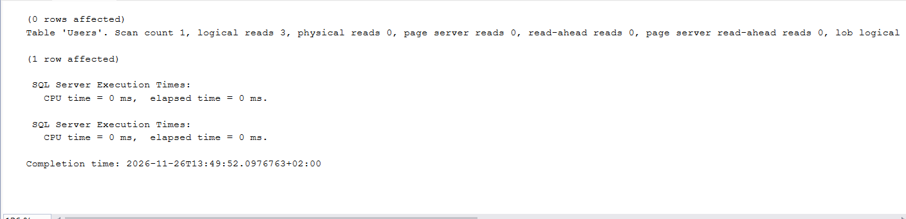

## Task 8

The Warning: 
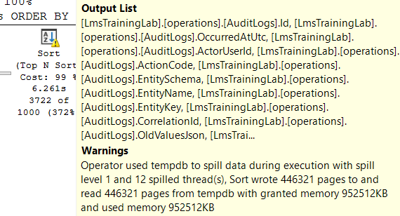

1. What happened?

- to sort audit log records by OccurredAtUtc DESC,
 The Sort operator required more memory than SQL Server had granted, so it spilled data to tempdb

2. Why did it happen?

- Because SQL Server estimated fewer rows would need sorting than the actual number of rows

3. What does Spill Level mean?

- Spill Level indicates how many levels of processing were needed to complete the spilled sort operation using tempdb

4. Why is it slow?

- Because instead of sorting everything in memory directly, SQL Server had to:
- Write intermediate sorting data to tempdb
- Read that data back

5. How did we fix it?

- We Created an index on OccurredAtUtc DESC
- SQL Server can now read records in the required order directly from the index

Actual Plan after fix :
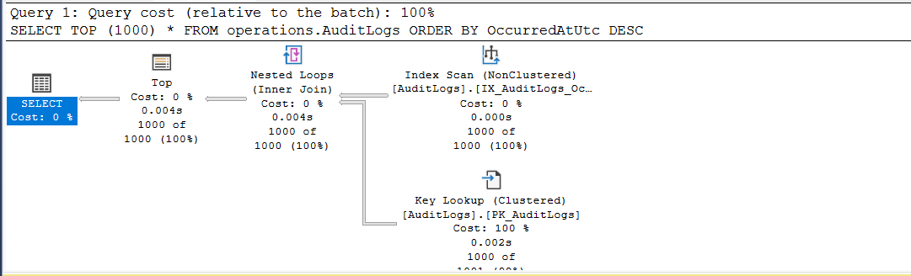

## Task 9

1. Actual plan - Disctinct no index :
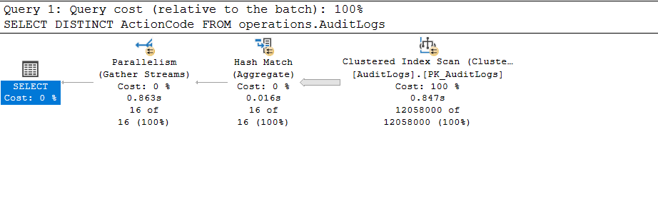

2. Operators

* Actual operator used is hash match :
- SQL Server reads the rows
- It hashes each value and groups identical values together
- It returns one row for each distinct value

* The cheaper alternative is Stream Aggregate : 
- It reads rows that are already ordered by the column
- It compares adjacent values
- When the value changes, it outputs a new distinct value

* What does SQL Server need to use Stream Aggregate?
- The input must be sorted by the column being grouped, usually through index or Sort

3. Actual plan - Distinct Unique Column :
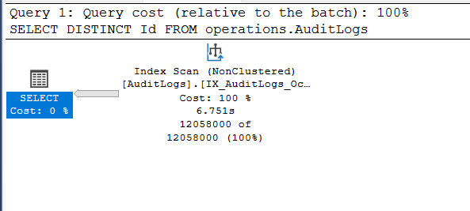

- SQL Server already knows that every Id is unique, so it doesn't need to remove duplicates,
 The execution plan doesn't need a Hash Match or Stream Aggregate

 ## Task 10 

1. When to use numbers:
- When IDs are generated by database
- You want smaller indexes and better storage efficiency
- When The system does not need to generate IDs independently

2. When to use GUIDs :
- Multiple systems generate records independently (no need for database to create it)
- Merge data from many servers with no Id conflicts
- IDs must be available before inserting records into the database

